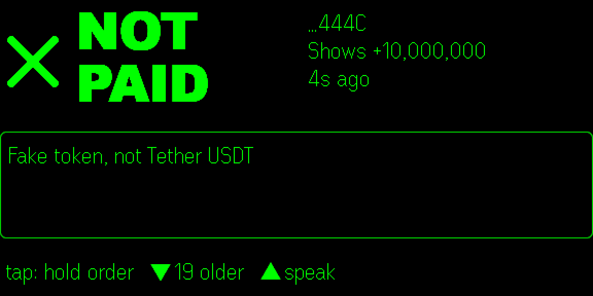
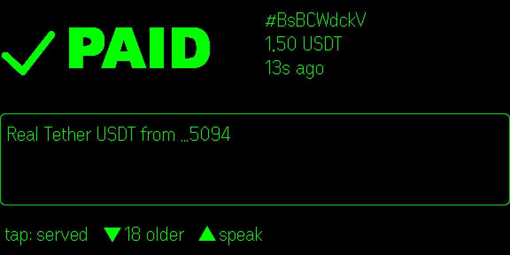
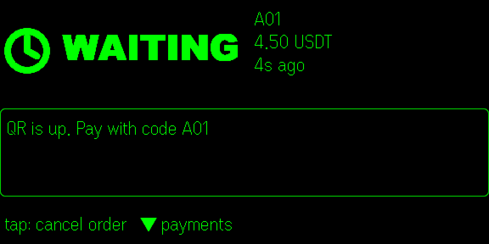
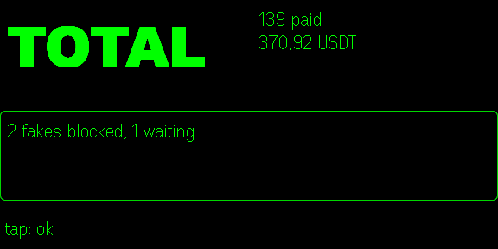
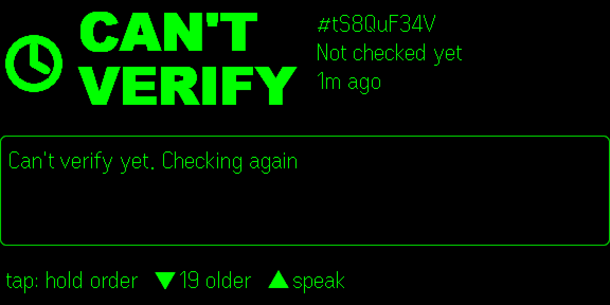

# PaidGlance

**Gram Wallet payments, checked on TON, shown on Even G2.** The clerk sees PAID or NOT PAID on the lens without looking at a phone. In our tests of 155 fake "USDT" transfers, 0 were marked paid.

| Fake token replayed from mainnet | Real Tether payment (live) | Order rung up by voice | Shift total | Lookup failed |
|---|---|---|---|---|
|  |  |  |  |  |

Demo video (2 min, English subtitles): see the BUIDL page.

Track: **Crypto & DeFi (Gram Wallet)**.

## The problem

A shop that takes crypto at the counter asks one question all day: did the money really arrive?

- In India, Paytm reports 13.7M (1.37 crore) merchant device subscriptions, such as the Soundbox speaker that reads each payment out loud ([Paytm Q2 FY26 earnings release, Nov 2025](https://nsearchives.nseindia.com/corporate/PAYTM_04112025215154_Reg30_Earnings_Release_FY26_Q2_OCL_sd.pdf)). Merchants pay for that because looking at a phone during a rush is slow.
- On TON, a token can call itself "USDT" and show up in a wallet with a big plus sign. In the first 3,000 jettons that tonapi lists we found **27** lookalike "USDT" tokens. tonapi blacklists all 27, but a notification or a quick glance does not tell you that.
- In May 2024 a TON phishing scam put "Received +5,000 USDT" in a transfer comment, so the wallet pop-up looked like money coming in. No USDT arrived ([Beosin, citing ScamSniffer](https://beosin.com/resources/ton-ecosystem-phishing-prevention-guide); [The Crypto Times](https://www.cryptotimes.io/2024/05/10/ton-phishing-message-scam-lures-users-with-5000-usdt-offer/)).

## What it does

1. The shop's Gram Wallet (or any TON wallet) address is watched on TON mainnet, read-only. PaidGlance reads public on-chain data through the public indexers toncenter and tonapi. No messages are shown: the lens shows an order code (or the payer's order reference) or the last 4 characters of an address, never the comment text.
2. Each incoming transfer is checked against the chain, not against the notification:
   - the jetton master is Tether's USD₮ contract (`EQCxE6mU…_sDs`),
   - the sender's jetton wallet is the one Tether's contract itself says belongs to the sender (`get_wallet_address`),
   - the transaction did not abort,
   - the amount covers the open order, if there is one.
3. The lens shows one card: **PAID**, **NOT PAID**, **SHORT**, **WAITING** or **CAN'T VERIFY**, with a reason of at most 40 characters (for example "Fake token, not Tether USDT").
4. If the Tether wallet lookup fails (tonapi down or rate limited), the transfer is **CAN'T VERIFY**, never PAID. It is checked again on the next poll and turns into PAID or NOT PAID once the lookup works.
5. The clerk taps the temple to mark the order served (or hold it). Swipe up and say "charge 4.50" to ring up an order: the counter screen shows a QR with the order code, and the lens waits for a payment with that code. Say "total" for the shift summary.

The verdict is plain code (`server/paidglance/verify.py`). No language model decides that money arrived.

**Payments without an order code.** Real USD₮ that carries no open order code is shown as PAID with the sender's tail, so a walk-in customer who types no code still counts. Below `PAIDGLANCE_MIN_NO_ORDER` (default 0.10 USD₮) such a transfer is treated as dust and hidden, so address-poisoning spam does not light up the lens. With an order code, the order amount is what counts, whatever the minimum. Set the minimum to 0 to turn it off.

## Does the check work? Tested on real mainnet transfers

<!-- eval:start -->
Data fetched 2026-11-23 18:36 UTC from toncenter and tonapi. Script: `eval/run_eval.py`. Raw results: `eval/results.json`, transfers: `eval/dataset.json`.

| | Naive notification baseline | PaidGlance |
|---|---|---|
| 155 incoming transfers of the 27 fake "USDT" tokens: marked paid | **155** | **0** |
| 60 recent real Tether USD₮ transfers: wrongly rejected | 0 / 60 | **0 / 60** |
| Sender's jetton wallet matches Tether's own answer | not checked | 40 / 40 |

All 60 real transfers went through the Tether master check. 40 of them also went through the canonical jetton-wallet lookup (the free tonapi tier allows about one request per second); the other 20 are scored on the master check alone. The live server looks up every USD₮ transfer and shows CAN'T VERIFY when the lookup fails.

The naive notification baseline judges from what a wallet push shows: a symbol that reads as USDT and an amount above zero, or a comment that claims USD was received. The 155 fake transfers had a face value of $22,518,275.47 "USDT". Real value: zero.
<!-- eval:end -->

Re-run offline with `python eval/run_eval.py --offline`, or live without the flag (a few minutes on the free API tier, about one request per second).

## Run it

Needs Node 20+ and Python 3.11+.

```bash
npm install
pip install faster-whisper          # only for voice; set PAIDGLANCE_NO_STT=1 to skip
python server/app.py                # backend on http://127.0.0.1:8787
npm run dev                         # Vite on http://localhost:5173
npm run simulate                    # Even Hub simulator
```

Environment variables (all optional):

| Variable | Default | Meaning |
|---|---|---|
| `PAIDGLANCE_ADDRESS` | a public merchant wallet on mainnet | the TON address to watch |
| `PAIDGLANCE_POLL` | `5` | seconds between chain checks |
| `PAIDGLANCE_MIN_NO_ORDER` | `0.10` | real USD₮ below this with no order code is ignored as dust; `0` turns it off |
| `PAIDGLANCE_DEMO` | off | `1` turns on the replay button and demo voice clips |
| `PAIDGLANCE_NO_STT` | off | `1` skips loading the speech model |
| `TONCENTER_API_KEY`, `TONAPI_KEY` | none | higher rate limits |
| `TELEGRAM_BOT_TOKEN`, `TELEGRAM_CHAT_ID` | none | also post each verdict to a Telegram chat |

Tests: `python -m unittest discover -s tests` (22 tests: verdicts, lookalike symbols, forged sender wallet, failed Tether lookup gives CAN'T VERIFY and is retried, dust minimum, comment scam, aborted tx, voice parsing, order lifecycle).

On real G2: `npm run pack` builds the `.ehpk`. The backend must be reachable from the phone; change the whitelist in `app.json` to your server's address.

## Judge's walkthrough (3 minutes)

1. Start the backend with `PAIDGLANCE_DEMO=1`, then `npm run dev`, then `npx evenhub-simulator "http://localhost:5173/?demo=1"`.
2. The lens fills with live payments to the watched wallet. Each one says PAID with the sender's tail. Tap: it becomes served.
3. `curl -X POST http://127.0.0.1:8787/api/replay-fake`: a real recorded fake-USDT transfer from mainnet is replayed. The lens jumps to NOT PAID, ahead of everything else.
4. Swipe up (scroll up at the top). In demo mode a recorded clip saying "charge four fifty" goes through the same speech-to-text path as the G2 mic. The counter page shows a QR for order A01.
5. Swipe up again: the clip says "total", and the lens shows the shift summary.
6. Optional: start the backend with `TONAPI_URL=http://127.0.0.1:9/v2` to simulate a tonapi outage. Real payments show CAN'T VERIFY instead of PAID.

## How it works

```
TON mainnet ──(toncenter v3, tonapi v2, read-only)──> server/app.py
   poll every 5 s: incoming jetton + TON transfers
   verify.py: Tether master? canonical wallet (lookup failed = CAN'T VERIFY)? aborted? amount vs order?
   store.py: orders, payments, shift totals (JSON file); CAN'T VERIFY rows are checked again
   stt.py: faster-whisper base.en on our own server, fixed grammar in voice.py
        │ HTTP on 127.0.0.1:8787
        ├── src/main.ts      G2 page via Even Hub SDK: verdict image, detail, reason, hint
        │                    tap / double tap / scroll, G2 mic (16 kHz PCM)
        └── src/counter.ts   counter screen: pay QR (ton:// link with order code), shift log
```

Lens layout (576×288): a 288×120 PNG verdict word with a mark (check, cross, clock), a detail text box, a bordered reason box (40 characters at most, so never more than two lines) and a one-line hint that captures input. Only the parts that change are redrawn. The firmware font has no `₮` glyph, so the lens writes USDT.

Card priority: a transfer that did NOT pay (or could not be verified) goes first, then an order waiting for payment, then the newest PAID. The card being read stays for 5 seconds even if new payments land.

## Limits, stated plainly

- **Indexed data only.** PaidGlance trusts what toncenter and tonapi have indexed. It does not wait for extra masterchain confirmations (finality) and does not run its own TON node.
- **Duplicate payments are not handled.** If a customer pays the same order twice, the second transfer shows as PAID without an order code. Refunds are up to the shop.
- **The fake set is mostly copycat tokens that tonapi already blacklists** (27 of 27). Our check does not use that blacklist; it compares the contract address. A forged record that names Tether's real contract is caught by the sender-wallet check, which is covered by unit tests but did not occur in the mainnet sample.
- **Replayed fakes are labelled.** The NOT PAID cards in the demo come from real fake-token transfers recorded from mainnet, replayed with the current time. The counter page tags them "replayed tx" and gives the original date. We did not send fake tokens to anyone.
- **The demo voice is a recorded clip** sent through the same speech-to-text path. The G2 mic path (`audioControl` + `audioEvent`) is in `src/main.ts` but was only run in the simulator.
- **The demo wallet belongs to a third party.** It is a busy public merchant wallet on TON mainnet, used read-only because it receives real USD₮ every few seconds. Only public on-chain data is read; no messages are shown. Set `PAIDGLANCE_ADDRESS` to your own.
- **A paid order end to end needs a real payment.** The order code and QR work; we did not pay ourselves in the video.
- **Comment-only scams** are covered by a unit test. We did not find a fresh sample on the demo wallet.
- **Telegram alerts** are implemented but were not run, because the demo has no bot token.
- Tested in the Even Hub simulator 0.7.3, not on G2 hardware.

## What existed before November 23

- The Even Hub minimal template (Vite + TypeScript + SDK), the Even Hub SDK, CLI and simulator.
- Libraries: `qrcode`, IBM Plex fonts, faster-whisper.
- The skeleton was drafted before the start; all commits in the public repo are after Nov 23 08:00 UTC.

## Feature requests

1. Even Hub SDK: a few currency glyphs (`₮`, `₹`, `€`) in the firmware font. Today the lens has to write USDT.
2. Even Hub SDK: a short haptic or tone call, so NOT PAID can be felt as well as seen.
3. Even Hub simulator: a headless mode (screenshots and input over the automation port, no windows) for CI.
4. Even Hub SDK: streaming audio with voice activity detection on the glasses, instead of a fixed recording window.
5. Gram Wallet: a merchant webhook or push feed for incoming jetton transfers, so a counter app does not need to poll public indexers.

## License

MIT. See `LICENSE`.
